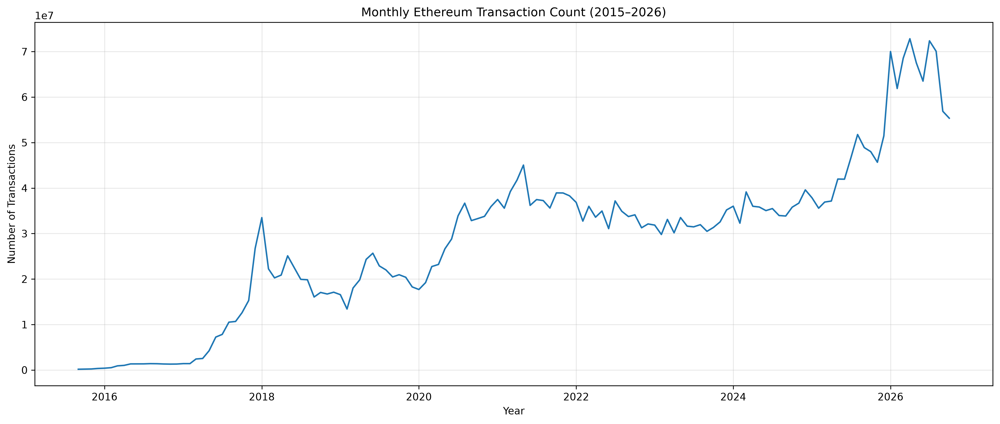
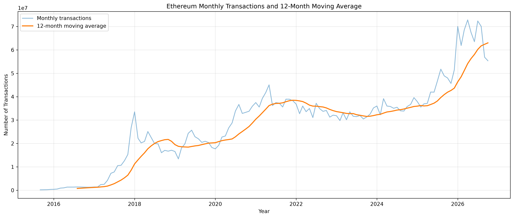
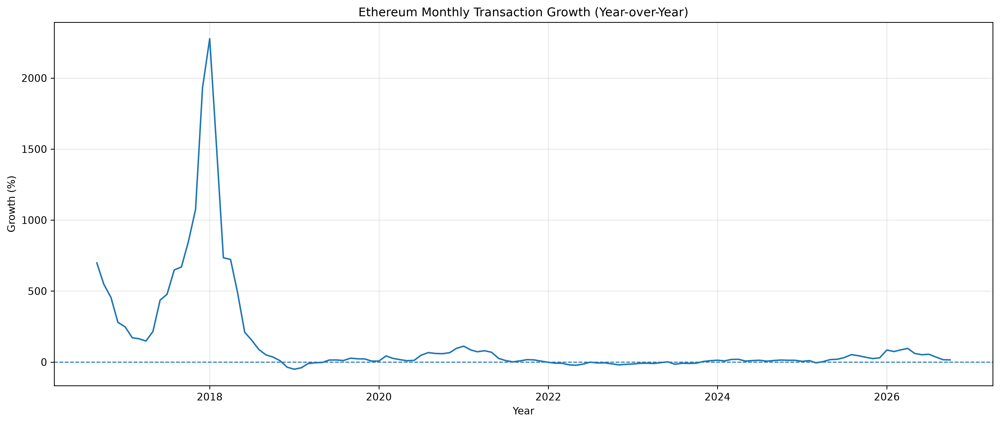
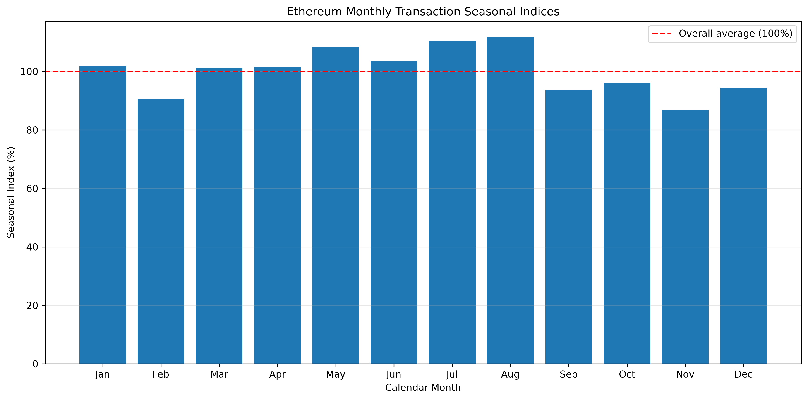
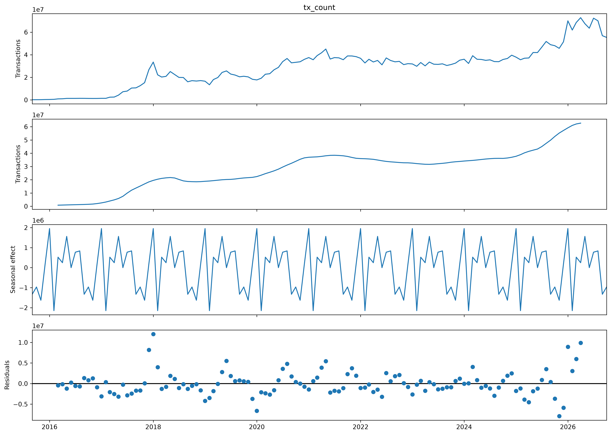
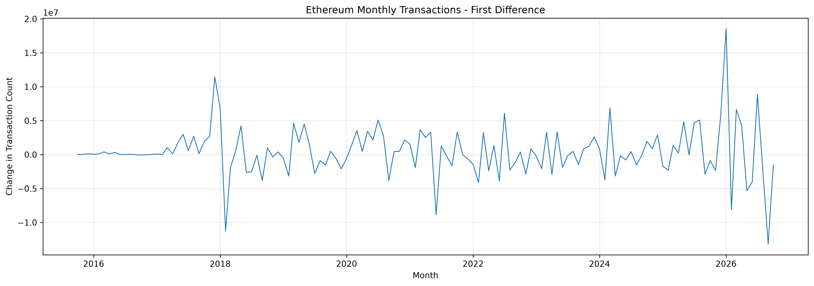
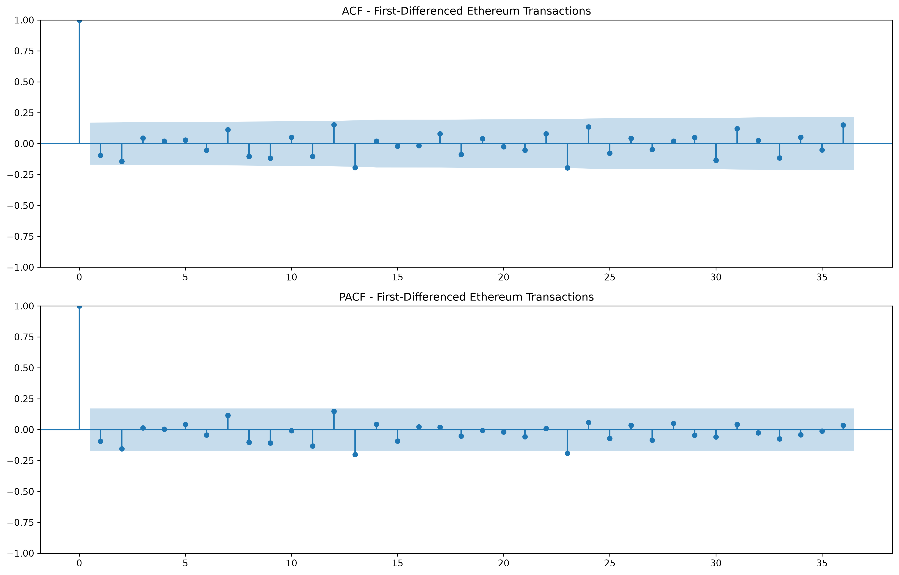
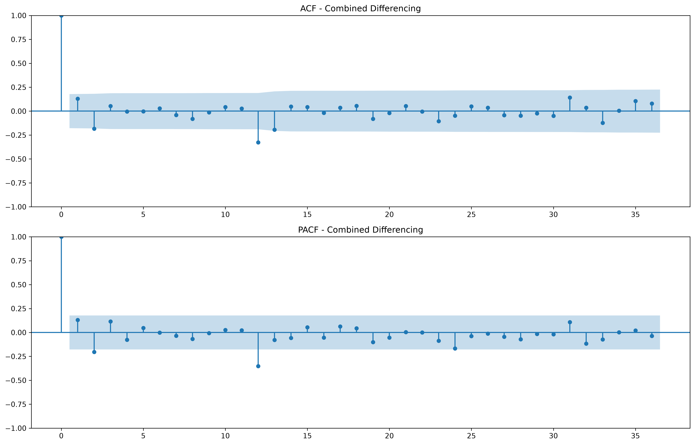
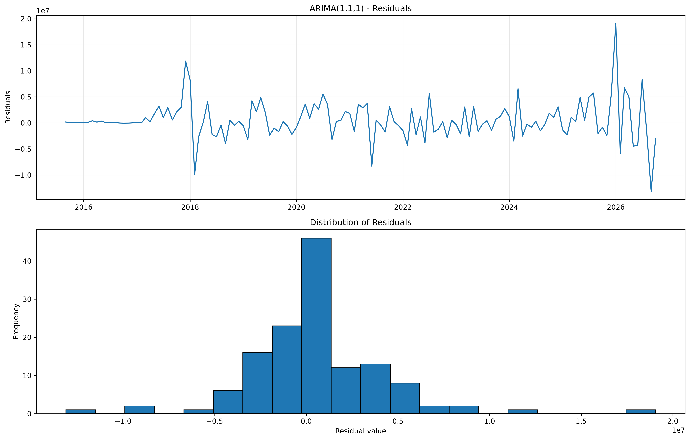

# Ethereum Monthly Transaction Time-Series Analysis (2015–2026)

**Report type:** Comprehensive monthly time-series analysis  
**Source notebook:** \`01_Ethereum_Monthly_TimeSeries_Analysis.ipynb\`  
**Study period:** September 2015–October 2026  
**Frequency:** Monthly  
**Observations:** 134  
**Data source:** Ethereum transaction-count dataset aggregated from Google BigQuery public blockchain data

---

## Abstract

This report examines the historical evolution of Ethereum monthly transaction activity from September 2015 to October 2026. The analysis includes data validation, descriptive statistics, trend smoothing, year-over-year growth, calendar-month comparisons, classical time-series decomposition, stationarity testing, differencing, ordinary ARIMA model comparison, residual diagnostics, and a preliminary seasonal ARIMA model.

Across 134 monthly observations, the dataset contains 3,822,444,185 transactions. The mean monthly transaction count is approximately 28.53 million, and the maximum is 72.83 million, recorded in April 2026. The original transaction-count series is nonstationary according to complementary ADF and KPSS tests. First-order differencing produces a series consistent with stationarity under both tests.

Among three ordinary ARIMA candidates, ARIMA(0,1,1) has the lowest AIC and BIC. However, its MA coefficient is not significant at the 5% level, and residual diagnostics indicate non-normality and heteroskedasticity. A preliminary SARIMA(0,1,1)(0,1,1)[12] model produces a significant seasonal MA coefficient, but it has not been evaluated using out-of-sample forecasting. The findings should therefore be interpreted as exploratory statistical results rather than a validated forecasting system.

## 1. Introduction and objectives

Ethereum network transaction counts provide one measure of blockchain activity. Examining their evolution over time can help characterize long-term network usage, changes in growth, and possible recurring temporal patterns.

The objectives of this monthly analysis are to:

1. Describe the historical evolution and distribution of monthly Ethereum transaction counts.
2. Examine year-over-year transaction growth.
3. Investigate calendar-month differences in average transaction activity.
4. Decompose the monthly series into trend, seasonal, and residual components.
5. assess stationarity using ADF and KPSS tests and evaluate transformations and differencing.
6. Compare selected ordinary ARIMA specifications.
7. Explore a preliminary seasonal ARIMA specification.

This report describes the analyses and results recorded in the source notebook. It does not add unperformed statistical tests or claim forecasting performance that was not evaluated.

## 2. Data and preparation

### 2.1 Dataset

The source file is \`data/raw/ethereum_monthly_txcount_full.csv\`. It contains two columns:

| Variable | Description |
|---|---|
| \`month\` | Monthly date |
| \`tx_count\` | Number of Ethereum transactions in the month |

The original dataset contains 136 observations from August 2015 through November 2026.

### 2.2 Data validation and analysis period

The notebook converted the month column to a datetime variable and checked data types, missing values, duplicate months, and the date range.

| Validation item | Result |
|---|---:|
| Original observations | 136 |
| First month | August 2015 |
| Last month | November 2026 |
| Missing month values | 0 |
| Missing transaction counts | 0 |
| Duplicate months | 0 |

The analysis retained September 2015 through October 2026, giving 134 consecutive monthly observations. The first and last observations of the original dataset were excluded from the principal analysis.

The cleaned series was saved as:

\`data/processed/ethereum_monthly_txcount_2015_2026.csv\`

### 2.3 Data scope

The analysis concerns monthly transaction counts. Transaction counts are an indicator of blockchain activity, but they do not independently measure unique users, economic value transferred, network adoption, or investment performance.

## 3. Descriptive statistics and historical trend

### 3.1 Descriptive statistics

| Statistic | Monthly transactions |
|---|---:|
| Observations | 134 |
| Mean | 28,525,702.87 |
| Standard deviation | 17,327,152.93 |
| Minimum | 173,805 |
| 25th percentile | 17,785,047.50 |
| Median | 32,034,452 |
| 75th percentile | 36,811,107.50 |
| Maximum | 72,827,602 |
| Total | 3,822,444,185 |

The minimum occurred in September 2015 and the maximum in April 2026.

The mean monthly count was approximately 28.53 million, while the median was approximately 32.03 million. The standard deviation of approximately 17.33 million indicates substantial variation over the study period. The wide range between the minimum and maximum is consistent with a series that changed considerably as Ethereum activity developed.

### 3.2 Monthly transaction series

The monthly transaction-count plot shows the observed history across the study period.

### 3.3 Twelve-month moving average

A 12-month rolling average was calculated to smooth short-term monthly fluctuations and make the underlying movement easier to inspect.

The moving average is a descriptive smoothing device; it is not a separate forecast.

## 4. Year-over-year transaction growth

Year-over-year growth was calculated as:

\[
YoY_t = \left(\frac{TX_t}{TX_{t-12}}-1\right)\times 100
\]

This calculation produced 122 valid observations.

| Statistic | YoY growth |
|---|---:|
| Observations | 122 |
| Mean | 139.62% |
| Standard deviation | 347.95 percentage points |
| Minimum | −50.54% |
| 25th percentile | 3.43% |
| Median | 17.10% |
| 75th percentile | 78.41% |
| Maximum | 2,276.76% |

The mean growth rate is much higher than the median. This difference indicates that a small number of exceptionally large growth observations influence the mean. The maximum growth rate of 2,276.76% is especially large and should be interpreted in the context of the small transaction-count base during Ethereum's early period.

The minimum YoY growth of −50.54% indicates that some months experienced substantial contraction relative to the same month in the preceding year. Overall, the results show that growth was highly variable rather than constant.

## 5. Calendar-month seasonality

The notebook calculated average transaction counts for each calendar month and expressed these averages as seasonal indices relative to the overall monthly mean:

\[
SI_m = \frac{\text{Average transactions in calendar month }m}
{\text{Overall monthly average}}\times 100
\]

An index of 100% corresponds to the overall monthly average.

| Calendar month | Average transactions | Seasonal index |
|---|---:|---:|
| January | 29,062,381 | 101.88% |
| February | 25,877,227 | 90.72% |
| March | 28,848,904 | 101.13% |
| April | 28,998,318 | 101.66% |
| May | 30,958,410 | 108.53% |
| June | 29,542,462 | 103.56% |
| July | 31,506,092 | 110.45% |
| August | 31,851,545 | 111.66% |
| September | 26,757,350 | 93.80% |
| October | 27,418,932 | 96.12% |
| November | 24,803,770 | 86.95% |
| December | 26,944,419 | 94.46% |

August has the highest seasonal index (111.66%), followed by July (110.45%). November has the lowest index (86.95%), followed by February (90.72%).

These differences are descriptive. The notebook does not perform a formal statistical test of calendar-month effects, so the observed pattern should not be described as statistically significant seasonality.

## 6. Classical time-series decomposition

The notebook applies classical additive decomposition with a seasonal period of 12 months:

\[
Y_t = T_t + S_t + R_t
\]

where \(Y_t\) is the observed transaction count, \(T_t\) is the estimated trend, \(S_t\) is the seasonal component, and \(R_t\) is the residual component.

The decomposition produces plots of the observed series, trend, seasonal component, and residuals.

The decomposition is used as a descriptive examination of the series. The notebook does not provide a numerical summary of the individual decomposition components; consequently, this report does not quantify their magnitudes or claim that the seasonal component is statistically significant.

## 7. Stationarity and transformations

Stationarity was assessed using two complementary tests:

- **Augmented Dickey–Fuller (ADF):** the null hypothesis is that the series has a unit root.
- **KPSS:** the null hypothesis is that the series is stationary around a constant.

The tests have different null hypotheses, so their results are interpreted together.

### 7.1 Original transaction-count series

| Test | Statistic | p-value |
|---|---:|---:|
| ADF | −1.2924 | 0.6326 |
| KPSS | 1.6523 | 0.01 |

The ADF test does not reject the unit-root null hypothesis, while the KPSS test rejects its stationarity null hypothesis. Together, these results support treating the original level series as nonstationary.

### 7.2 First-order differencing

The first difference is:

\[
\Delta Y_t = Y_t - Y_{t-1}
\]

The differenced series contains 133 observations.

| Test | Statistic | p-value |
|---|---:|---:|
| ADF | −9.5992 | 1.9414 × 10⁻¹⁶ |
| KPSS | 0.0437 | 0.10 |

The ADF test rejects the unit-root null hypothesis, and the KPSS test does not reject its stationarity null hypothesis. These results provide evidence that first-order differencing produces a stationary series under the test specifications used.

The notebook also examines the ACF and PACF of the first-differenced series up to 36 lags.

### 7.3 Logarithmic transformation and log differencing

The notebook also examines the natural logarithm of the transaction-count series and its first difference:

\[
Z_t = \ln(Y_t)
\]

\[
\Delta Z_t = \ln(Y_t)-\ln(Y_{t-1})
\]

The log-differenced series contains 133 observations.

| Measure | Result |
|---|---:|
| ADF statistic | −2.0878 |
| ADF p-value | 0.2495 |
| KPSS statistic | 0.7696 |
| KPSS p-value | 0.01 |
| Standard deviation of first difference | 3,695,033.93 |
| Standard deviation of log difference | 0.1505 |

The ADF test does not reject the unit-root null hypothesis, while the KPSS test rejects its stationarity null hypothesis. Under these test specifications, the log-differenced series is not supported as stationary.

The standard deviations are expressed on different scales and should not be compared as if they measured the same quantity.

### 7.4 Seasonal differencing

Seasonal differencing was performed with a 12-month lag:

\[
\Delta_{12}Y_t = Y_t-Y_{t-12}
\]

The resulting series contains 122 observations.

| Test | Statistic | p-value |
|---|---:|---:|
| ADF | −2.2511 | 0.1882 |
| KPSS | 0.1720 | 0.10 |

The ADF test does not reject the unit-root null hypothesis, while the KPSS test does not reject the stationarity null hypothesis. The results are therefore mixed and do not establish stationarity conclusively.

### 7.5 Combined first-order and seasonal differencing

The notebook also applies first-order and seasonal differencing:

\[
\Delta\Delta_{12}Y_t
\]

The resulting series contains 121 observations.

| Test | Statistic | p-value |
|---|---:|---:|
| ADF | −4.4304 | 0.0002621 |
| KPSS | 0.0410 | 0.10 |

The ADF test rejects the unit-root null hypothesis, while the KPSS test does not reject its stationarity null hypothesis. The combined-differenced series is therefore consistent with stationarity under these tests.

The notebook calculates and plots ACF and PACF values for this transformed series up to 36 lags.

## 8. Ordinary ARIMA modelling

### 8.1 Baseline ARIMA(1,1,1)

A baseline ARIMA(1,1,1) model was fitted to the original transaction-count series.

| Model statistic | Result |
|---|---:|
| Observations | 134 |
| Log likelihood | −2,199.497 |
| AIC | 4,404.995 |
| BIC | 4,413.666 |

| Parameter | Coefficient | p-value |
|---|---:|---:|
| AR(1) | 0.3262 | 0.542 |
| MA(1) | −0.4378 | 0.384 |

Neither estimated coefficient is statistically significant at the 5% level.

### 8.2 Baseline residual diagnostics

| Diagnostic | Statistic | p-value |
|---|---:|---:|
| Ljung–Box, lag 1 | 0.00 | 0.99 |
| Ljung–Box, lag 12 | 11.6608 | 0.4733 |
| Ljung–Box, lag 24 | 27.6530 | 0.2749 |
| Jarque–Bera | 205.50 | 0.00 |
| Heteroskedasticity | 2.23 | 0.01 |

The Ljung–Box results do not indicate residual autocorrelation at lags 12 and 24 under the reported tests. However, the Jarque–Bera test indicates non-normal residuals, and the heteroskedasticity test indicates non-constant residual variance.

The model summary also reports a singular or near-singular covariance matrix, meaning that coefficient standard errors may be unstable.

### 8.3 Comparison of candidate ordinary ARIMA models

Three candidate models were compared using AIC, BIC, and log likelihood.

| Model | AIC | BIC | Log likelihood |
|---|---:|---:|---:|
| ARIMA(0,1,1) | **4,403.611** | **4,409.392** | −2,199.805 |
| ARIMA(1,1,0) | 4,403.839 | 4,409.620 | −2,199.919 |
| ARIMA(1,1,1) | 4,404.995 | 4,413.666 | −2,199.497 |

ARIMA(0,1,1) has the lowest AIC and BIC among the three candidates and is therefore the preferred ordinary ARIMA specification in this limited comparison.

### 8.4 Selected ARIMA(0,1,1)

| Statistic | Result |
|---|---:|
| Observations | 134 |
| Log likelihood | −2,199.805 |
| AIC | 4,403.611 |
| BIC | 4,409.392 |
| MA(1) coefficient | −0.1069 |
| MA(1) p-value | 0.068 |

The MA(1) coefficient is not statistically significant at the conventional 5% level.

| Diagnostic | Statistic | p-value |
|---|---:|---:|
| Ljung–Box, lag 1 | 0.00 | 0.96 |
| Jarque–Bera | 212.89 | 0.00 |
| Heteroskedasticity | 2.22 | 0.01 |

The residuals exhibit evidence of non-normality and heteroskedasticity. The model summary also reports a near-singular covariance matrix.

**Interpretation:** ARIMA(0,1,1) is the preferred candidate according to AIC and BIC among the three ordinary ARIMA specifications tested. This does not establish that it is an adequate forecasting model. Its coefficient uncertainty and residual diagnostic limitations should be considered, and out-of-sample validation is still required.

## 9. Preliminary seasonal ARIMA modelling

To investigate annual dynamics, the notebook fits:

\[
SARIMA(0,1,1)(0,1,1)_{12}
\]

The model uses a non-seasonal order of (0,1,1), a seasonal order of (0,1,1,12), and sets \`enforce_stationarity=False\` and \`enforce_invertibility=False\`.

### 9.1 Model results

| Statistic | Result |
|---|---:|
| Observations | 134 |
| Log likelihood | −1,774.809 |
| AIC | 3,555.618 |
| BIC | 3,563.636 |

| Parameter | Coefficient | p-value |
|---|---:|---:|
| MA(1) | 0.0549 | 0.564 |
| Seasonal MA(12) | −0.8020 | 0.000 |

The seasonal MA coefficient is statistically significant, whereas the non-seasonal MA coefficient is not.

### 9.2 Residual diagnostics

| Diagnostic | Statistic | p-value |
|---|---:|---:|
| Ljung–Box, lag 1 | 0.10 | 0.75 |
| Jarque–Bera | 137.49 | 0.00 |
| Heteroskedasticity | 1.67 | 0.13 |

The reported Ljung–Box test does not indicate residual autocorrelation at lag 1, and the heteroskedasticity test does not reject constant variance at the 5% level. The Jarque–Bera test indicates non-normal residuals. The model summary also reports a near-singular covariance matrix.

### 9.3 Interpretation and limitations

This is a preliminary seasonal model, not a validated forecasting result. The notebook does not report a chronological holdout evaluation, rolling-origin validation, forecast accuracy measures, or a comprehensive multi-lag seasonal residual diagnostic assessment.

AIC values should not be compared mechanically between ordinary ARIMA and SARIMA specifications that use different differencing structures and likelihood specifications. The lower numerical AIC of the seasonal model alone is not sufficient to establish that it is superior.

## 10. Visualization inventory

The following figures are generated by the notebook and are present in the repository's \`visualizations/\` directory.

| Figure | File | Description |
|---:|---|---|
| 1 | \`01_monthly_transaction_count.png\` | Monthly transaction count |
| 2 | \`02_monthly_transactions_12m_moving_average.png\` | Monthly transactions and 12-month moving average |
| 3 | \`03_yoy_transaction_growth.png\` | Year-over-year transaction growth |
| 4 | \`04_monthly_seasonal_indices.png\` | Calendar-month seasonal indices |
| 5 | \`05_time_series_decomposition.png\` | Classical additive decomposition |
| 6 | \`06_first_order_differencing.png\` | First-order differenced series |
| 7 | \`07_acf_pacf_first_difference.png\` | ACF and PACF after first differencing |
| 9 | \`09_arima_111_residual_diagnostics.png\` | ARIMA(1,1,1) residual diagnostics |
| 10 | \`10_acf_pacf_combined_differencing.png\` | ACF and PACF after combined differencing |

Figure 08 is not present in the notebook's saved visualization sequence. The original figure filenames and numbering have been retained.

## 11. Discussion

The monthly transaction-count series records substantial changes in Ethereum network activity over the period examined. The descriptive statistics show a wide range of monthly transaction counts and substantial dispersion around the mean.

Year-over-year growth is highly variable. Its mean is much higher than its median because exceptionally large growth observations influence the average, particularly when the initial transaction-count base is small.

The calendar-month averages show higher observed activity in July and August and lower averages in November and February. These are descriptive comparisons only; the notebook does not test whether calendar-month effects are statistically significant.

The stationarity tests indicate that the original level series is nonstationary. First-order differencing produces results consistent with stationarity under both ADF and KPSS tests. Seasonal differencing alone produces mixed results, while combined first-order and seasonal differencing is consistent with stationarity under the reported tests.

Among the ordinary ARIMA candidates, ARIMA(0,1,1) has the lowest AIC and BIC. However, the MA coefficient is not significant at the 5% level, and residual diagnostics indicate non-normality and heteroskedasticity. The preliminary SARIMA model has a significant seasonal MA coefficient, but the notebook does not establish its out-of-sample forecasting performance.

## 12. Limitations and recommendations

The following limitations should be considered when interpreting the results.

1. **Descriptive seasonality:** Calendar-month differences are not accompanied by a formal significance test.
2. **Structural changes:** The analysis does not formally test for structural breaks in the monthly transaction-count series.
3. **Model diagnostics:** More comprehensive residual diagnostics are needed, especially for seasonal autocorrelation and parameter stability.
4. **Forecast validation:** Neither the selected ordinary ARIMA model nor the preliminary SARIMA model is evaluated using a chronological holdout or rolling-origin procedure.
5. **Benchmark comparison:** Future forecasting work should compare ARIMA/SARIMA models with naïve and seasonal-naïve benchmarks.
6. **Additional explanatory variables:** Transaction counts alone cannot explain the drivers of network activity. Future analysis could incorporate active addresses, gas prices, ETH prices, and other network indicators.
7. **Interpretation of transaction counts:** Transaction counts do not directly measure unique users, economic value transferred, or investment returns.

Recommended next steps are to conduct formal seasonal testing, investigate possible structural changes, expand residual diagnostics, and evaluate forecasting models using time-ordered validation and appropriate benchmark methods.

## 13. Conclusion

This study provides an exploratory statistical analysis of Ethereum monthly transaction activity from September 2015 through October 2026. It documents substantial variation in transaction counts and growth, describes calendar-month averages, applies classical decomposition, evaluates stationarity, and compares ordinary and seasonal ARIMA specifications.

The clearest stationarity result is that first-order differencing produces a series consistent with stationarity under both ADF and KPSS tests. ARIMA(0,1,1) has the lowest AIC and BIC among the three ordinary ARIMA candidates considered, but its coefficient and residual diagnostics warrant caution. The seasonal ARIMA model is preliminary and requires out-of-sample validation.

The report therefore establishes a reproducible exploratory foundation for further monthly Ethereum time-series research. It does not claim that a forecasting model has yet been validated.

---

*Prepared from the outputs and analyses recorded in the monthly source notebook. Numerical results are reported as shown in that notebook; interpretations and limitations are distinguished from the notebook's direct statistical outputs.*
